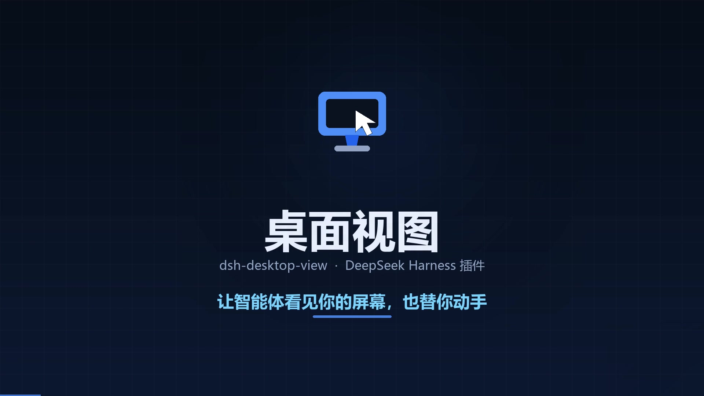
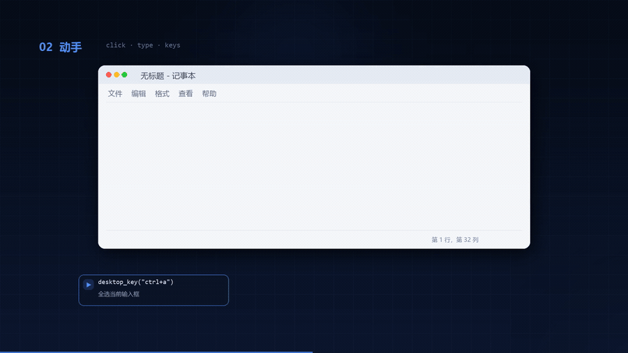
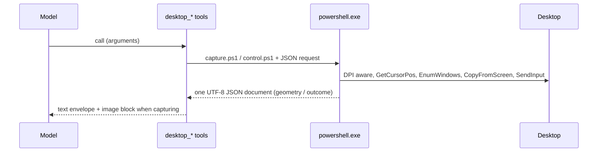

# Desktop View · dsh-desktop-view

> Eyes and hands for the [DeepSeek Harness](https://github.com/deepseek-ai/deepseek-harness) agent: it can see your Windows desktop, and move, click, drag, scroll, type, press keys, and manage windows for you.

[中文](README.md)

[](https://github.com/videndi/dsh-desktop-view/releases/download/v0.2.0/dsh-desktop-view-promo.mp4)

**Observation (read-only)**

| Tool | One line |
| --- | --- |
| `desktop_snapshot` | Capture the whole virtual desktop or one monitor; returns the image, pointer position, monitor layout and window titles |
| `desktop_cursor` | Read the pointer alone: position, monitor, window under the pointer, foreground window; no capture, nearly free |

**Input**

| Tool | One line |
| --- | --- |
| `desktop_move` | Move the pointer to a position (hover, reveal tooltips, line up a drag) |
| `desktop_click` | Click at a position or at the pointer; left/right/middle, 1–5 clicks (double, triple) |
| `desktop_drag` | Press at a start point, move smoothly to an end point, release (windows, sliders, selections, files) |
| `desktop_scroll` | Wheel at the pointer or at a position; vertical or horizontal |
| `desktop_type` | Type text into the focused control; newline=Enter, tab=Tab, everything else as Unicode, so non-Latin text needs no layout switch |
| `desktop_key` | Press a key or chord: `enter`, `esc`, `ctrl+c`, `alt+tab`, `win+r`, `ctrl+shift+esc`… |
| `desktop_window` | List visible windows, or focus, minimize, maximize, restore, or close one |

Every input tool reports the pointer position and foreground window it left behind, so each step can be checked.

## Why

An agent can read files and run commands, but it cannot see the thing you are looking at, and it cannot click the button for you. Questions like "what is this error" or "close that window" end in a counter-question. With this plugin installed:

- **See the screen**: one `desktop_snapshot` puts the picture into context — inlined when the model route accepts images, otherwise the absolute path of a local PNG.
- **See the pointer**: `desktop_cursor` returns pixel coordinates and the window under the pointer.
- **Act**: `desktop_click`, `desktop_type`, `desktop_key` and `desktop_window` cover everyday interaction; coordinates come from the capture and every action reports its landing state.
- **Locate a control**: the capture carries the monitor layout and display scale, and reports screen and image coordinates together.

## Features

- **Whole desktop or one monitor**: all displays are stitched into one image by default; `monitor` captures just one.
- **DPI aware**: capture and input both run after `SetProcessDPIAware`, so a 200% display is consistent.
- **Multi-monitor**: the union of the virtual desktop, including negative origins on a left-hand secondary display.
- **Pointer ring**: `CopyFromScreen` does not include the cursor, so the plugin draws a white ring, red dot and four ticks; `mark_cursor: false` disables it.
- **Window context**: title, window class, process name, PID and handle for the foreground window and the window under the pointer.
- **Two coordinate spaces**: `screen (x, y)` and `image (x, y)` together, consistent across `max_width` downscaling.
- **Unicode typing**: `desktop_type` injects Unicode, so Chinese or Japanese text needs no keyboard layout.
- **Readable failures**: out-of-range points, missing windows and unknown key names report clearly instead of doing nothing.
- **Private by default**: local only, no network, no telemetry; PNGs in `~/.dsh/desktop-view/snapshots`, newest 40 kept.
- **No native dependency**: plain Windows PowerShell 5.1 plus .NET — nothing to compile or install.

## Video

38 seconds, four beats: see the screen, act on it, manage windows, install with one command. Click the cover for the full MP4 (3 MB); the clip below is the input section:



A vertical 9:16 cut (1080×1920, for TikTok / Reels / Shorts) sits in the same release: [download the vertical version](https://github.com/videndi/dsh-desktop-view/releases/download/v0.2.0/dsh-desktop-view-promo-vertical.mp4) (2.6 MB).

## Install

Requires Windows 10/11, DeepSeek Harness 0.2.x, and Node ≥ 22 in the host.

Install straight from GitHub through the Harness plugin manager (no clone needed):

```text
plugin_manager install_bundle  target: github:videndi/dsh-desktop-view
```

> This route needs `git` on the machine (`winget install Git.Git` on Windows).
> After installing git, **restart Harness**: a running process does not re-read
> PATH, and the install would fail with `git ls-remote failed`.

Or clone and install the directory (handy while developing):

```bash
git clone https://github.com/videndi/dsh-desktop-view.git
```

```text
plugin_manager install_bundle  target: <absolute path of the clone>
```

Remove it with `plugin_manager remove_bundle` (or set the row to `enabled: false`); the data directory `~/.dsh/desktop-view` can be deleted at any time.

> Do not hand-edit the profile's `package.json` or `cordis.patch.yml`: `install_bundle` writes the dependency and the patch row correctly.

## Use

```text
desktop_snapshot(monitor?: 1..N, max_width?: int, mark_cursor?: bool)
desktop_cursor()
desktop_move(x, y)
desktop_click(x?, y?, button?: left|right|middle, count?: 1..5)
desktop_drag(from_x, from_y, to_x, to_y, button?, duration_ms?)
desktop_scroll(delta, x?, y?, horizontal?)
desktop_type(text, interval_ms?)
desktop_key(keys)
desktop_window(operation?: list|focus|minimize|maximize|restore|close, title?, hwnd?)
```

A real sequence that writes into Notepad:

```text
desktop_window(operation: "list", title: "Notepad")
  → 1. 0x000708C6 "Untitled - Notepad" — notepad (pid 3636), 2694x1344 at (76, 542), foreground

desktop_window(operation: "minimize", title: "Notepad")
  → minimized · "Untitled - Notepad" (notepad, pid 3636)

desktop_window(operation: "restore", title: "Notepad")
  → restored · "Untitled - Notepad" (notepad, pid 3636)

desktop_key(keys: "ctrl+a")
  → pressed ctrl+a · pointer (1637, 277)

desktop_type(text: "replaced by plugin")
  → typed 18 characters · pointer (1637, 277)

desktop_snapshot(max_width: 1100)
  → text envelope + image content block
```

The text half of a `desktop_snapshot` result looks like this (window titles anonymized):

```text
<desktop>
captured: 2026-01-02T03:04:05+08:00
region: virtual-desktop — 4480x1440 at (-2560, 0)
image: C:\Users\me\.dsh\desktop-view\snapshots\desktop-20260102-030405-120.png (2240x720, downscaled from 4480x1440)
pointer: screen (100, 200) · image (50, 100) · monitor 1
monitors:
  - 1: 1920x1080 at (0, 0) primary
  - 2: 2560x1440 at (-2560, 0)
foreground: notepad (pid 42) "Untitled - Notepad"
under pointer: explorer (pid 7) "Program Manager"
display scale: 150%
</desktop>
```

When the model route accepts image input, the same result also carries an `image` content block with the capture itself.

## Safety

- **Captures enter model context**: a screen may hold passwords, chats, or a meeting window. Use it only when you are comfortable with that.
- **Input tools really operate the machine**: clicks, edits and window closures are not undoable. Take a `desktop_snapshot` first, then act in small steps.
- **Kill switch**: set `DSH_DESKTOP_CONTROL=off` in the environment that launches Harness and the seven input tools refuse with an error instead of injecting anything; observation is unaffected.
- **Bounded**: points outside the virtual screen are refused, and unknown key names are refused rather than guessed.

## How it works



- `index.js` registers nine tools as **raw JSON-Schema definitions** and validates its own arguments, because an out-of-tree bundle cannot resolve the harness packages by import.
- Each call starts one short-lived `powershell.exe -NoProfile -NonInteractive`: `capture.ps1` for the screenshot and geometry, `control.ps1` for `SendInput` and window operations; `Add-Type` compiles a small P/Invoke helper per process.
- The helper writes a JSON file that Node reads, so **localized console output is never parsed**.
- Capture and input share one DPI-aware coordinate space, so a point seen in the image is the point that gets clicked.
- Images go through the host `attachments` service; they are inlined only when the resolved model route declares `image` input.

## Layout

```text
index.js              the nine tool definitions and their orchestration
lib/scene.js          pure helpers: geometry and the observation envelope (unit-tested)
lib/control.js        pure helpers: key-chord parsing and the action envelope (unit-tested)
lib/powershell.js     the one PowerShell process wrapper (temp-JSON protocol)
scripts/capture.ps1   the capture and geometry collector
scripts/control.ps1   the input and window-operation executor
locale/{en,zh}.json   plugin-manager title and description
icon.svg              plugin icon
test/                 node:test unit tests
cordis.patch.yml      the bundle's loader rows
```

## Development

```bash
node --check index.js lib/scene.js lib/control.js lib/powershell.js
node --test
```

Tests never touch a real desktop: pure-function cases run directly, and tool cases register through a stub `ctx` to check schemas, rendering and argument validation; only the off-Windows case is skipped by platform.

## Compatibility

- Windows 10 / 11 (the bundled Windows PowerShell 5.1 is enough)
- DeepSeek Harness 0.2.x tool registration and `attachments` service
- Host Node ≥ 22 (ESM, `AbortSignal`, `node:test`)

## License

[MIT](LICENSE)
