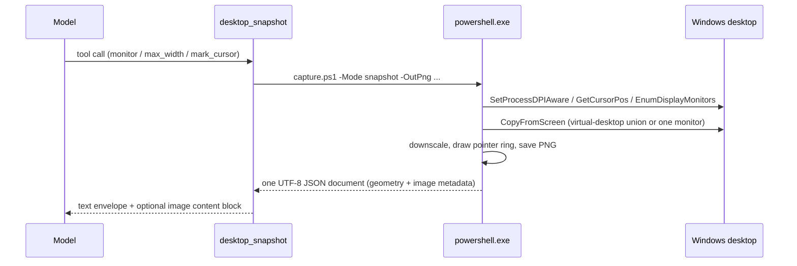

# Desktop View · dsh-desktop-view

> Eyes for the [DeepSeek Harness](https://github.com/deepseek-ai/deepseek-harness) agent: a read-only plugin that lets it see your Windows desktop and pointer.

[中文](README.md)

| Tool | One line |
| --- | --- |
| `desktop_snapshot` | Capture the whole virtual desktop or one monitor; returns the image, pointer position, monitor layout and window titles |
| `desktop_cursor` | Read the pointer alone: position, monitor, window under the pointer, foreground window; no capture, nearly free |

Both tools are **read-only**. They never move the pointer, click, or inject keystrokes.

## Why

An agent can read files and run commands, but it cannot see the thing you are looking at. Questions like "what is this error on my screen" or "where is my mouse" end in a counter-question. With this plugin installed:

- **See the screen**: one `desktop_snapshot` call puts the picture into context — inlined when the model route accepts images, otherwise as the absolute path of a local PNG.
- **See the pointer**: one `desktop_cursor` call returns pixel coordinates and the window under the pointer, cheap enough to call every step.
- **Locate a control**: the capture carries the monitor layout and display scale, and reports screen and image coordinates together, converting automatically after downscaling.

## Features

- **Whole desktop or one monitor**: all displays are stitched into one image by default; `monitor` captures just one.
- **DPI aware**: coordinates are physical pixels after `SetProcessDPIAware`, so a 200% display is not off by half.
- **Multi-monitor**: monitors are handled as the union of the virtual desktop, including negative origins on a left-hand secondary display.
- **Pointer ring**: `CopyFromScreen` does not include the cursor, so the plugin draws a white ring, red dot and four ticks itself; `mark_cursor: false` disables it.
- **Window context**: the foreground window and the window under the pointer, each with title, window class, process name and PID.
- **Two coordinate spaces**: `screen (x, y)` and `image (x, y)` are returned together and stay consistent when `max_width` downscales the capture.
- **Private by default**: local capture only, no network, no telemetry; PNGs live in `~/.dsh/desktop-view/snapshots` and only the newest 40 are kept.
- **No native dependency**: plain Windows PowerShell 5.1 plus .NET `System.Drawing` — nothing to compile or install.

## Install

Requires Windows 10/11, DeepSeek Harness 0.2.x, and Node ≥ 22 in the host.

Install the directory through the Harness plugin manager (it writes the profile dependency and patch correctly; do not hand-edit `package.json` or `cordis.patch.yml`):

```text
plugin_manager install_bundle  target: <absolute path of this repo>
```

Or clone first:

```bash
git clone https://github.com/Gaoler006115/dsh-desktop-view.git
```

then run `install_bundle` against the clone. Remove it with `plugin_manager remove_bundle`; the data directory `~/.dsh/desktop-view` can be deleted at any time.

## Use

```text
desktop_snapshot(monitor?: 1..N, max_width?: int, mark_cursor?: bool)
desktop_cursor()
```

| Parameter | Default | Meaning |
| --- | --- | --- |
| `monitor` | every display | A `monitors[].index` from a previous result; capture only that display |
| `max_width` | `0` (native) | Downscale to at most this width; smaller costs fewer image tokens and less detail |
| `mark_cursor` | `true` | Draw a ring at the pointer; turn it off for an unobstructed view |

The text half of a `desktop_snapshot` result looks like this (window titles anonymized):

```text
<desktop>
captured: 2026-01-02T03:04:05+08:00
region: virtual-desktop — 4480x1440 at (-2560, 0)
image: C:\Users\me\.dsh\desktop-view\snapshots\desktop-20260102-030405-120.png (2240x720, downscaled from 4480x1440)
pointer: screen (100, 200) · image (50, 100) · monitor 1
monitors:
  - 1: 1920x1080 at (0, 0) primary
  - 2: 2560x1440 at (-2560, 0)
foreground: notepad (pid 42) "Untitled - Notepad"
under pointer: explorer (pid 7) "Program Manager"
display scale: 150%
</desktop>
```

When the model route accepts image input, the same result also carries an `image` content block with the capture itself. When it does not, the result carries only the path plus one hint line, and the caller decides how to read the pixels.

## How it works



- `index.js` registers both tools as **raw JSON-Schema definitions** and validates its own arguments, because an out-of-tree bundle cannot resolve the harness packages by import.
- Each observation starts one short-lived `powershell.exe -NoProfile -NonInteractive` and compiles a small P/Invoke helper with `Add-Type`; the process exits and cleans up.
- The helper writes a JSON file that Node reads, so **localized console output is never parsed** — an English or Chinese Windows behaves the same.
- Images go through the host `attachments` service; they are inlined only when the resolved model route declares `image` input, so a text-only route is never broken.

## Layout

```text
index.js              the two tool definitions and their orchestration
lib/scene.js          pure helpers: geometry and the text envelope (unit-tested, no I/O)
scripts/capture.ps1   the PowerShell collector: P/Invoke, capture, JSON output
locale/{en,zh}.json   plugin-manager title and description
icon.svg              plugin icon
test/                 node:test unit tests
cordis.patch.yml      the bundle's loader rows
```

## Development

```bash
node --check index.js lib/scene.js
node --test
```

Tests never touch a real desktop: pure-function cases run directly, and tool cases register through a stub `ctx` to check schemas, rendering and argument validation.

## Compatibility

- Windows 10 / 11 (the bundled Windows PowerShell 5.1 is enough)
- DeepSeek Harness 0.2.x tool registration and `attachments` service
- Host Node ≥ 22 (ESM, `AbortSignal`, `node:test`)

## Privacy

This plugin puts your screen into model context — use it only when you are comfortable with that, and remember a capture can contain passwords, chats, or a meeting window. Everything stays local: no network calls, no telemetry, and the snapshot directory can be cleared at any time. See [SECURITY.md](SECURITY.md).

## License

[MIT](LICENSE)
