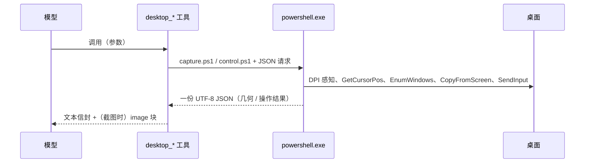

# 桌面视图 · dsh-desktop-view

> 给 [DeepSeek Harness](https://github.com/deepseek-ai/deepseek-harness) 的智能体装上眼睛和手：看得见你的 Windows 桌面，也能替你移动、点击、拖拽、滚动、打字、按快捷键、管理窗口。

[English](README.en.md)

**观察（只读）**

| 工具 | 一句话 |
| --- | --- |
| `desktop_snapshot` | 截图（整块虚拟桌面或指定显示器），返回画面 + 鼠标坐标 + 显示器布局 + 窗口标题 |
| `desktop_cursor` | 只读鼠标位置：坐标、所在显示器、指针下的窗口、前台窗口；不截图，几乎零成本 |

**操作**

| 工具 | 一句话 |
| --- | --- |
| `desktop_move` | 把指针移到指定坐标（悬停、露出提示框、对齐拖拽起点） |
| `desktop_click` | 在坐标处点击，或点击当前指针；左/右/中键，1–5 次（双击、三击） |
| `desktop_drag` | 从起点按下、平滑移动到终点、松开（拖窗口、拖滑块、框选、拖文件） |
| `desktop_scroll` | 在指针处或指定坐标滚轮（纵向/横向） |
| `desktop_type` | 往当前焦点输入文本；换行=回车、Tab=Tab，其余字符按 Unicode 输入，中文/日文/emoji 无需切输入法 |
| `desktop_key` | 按一个键或组合键：`enter`、`esc`、`ctrl+c`、`alt+tab`、`win+r`、`ctrl+shift+esc`… |
| `desktop_window` | 列出可见窗口，或对某个窗口聚焦/最小化/最大化/还原/关闭 |

所有工具都返回"操作之后"的指针位置和前台窗口，所以每一步都能确认落点对不对。

## 它解决什么

智能体平时只能读文件、跑命令，看不到"你正在看的那个东西"，也没法替你点那一下。于是"这个报错帮我看看"、"这个窗口帮我关掉"、"把这段填进那个输入框"都得你自己来。装上这个插件后：

- **看屏幕**：一次 `desktop_snapshot`，画面直接进上下文（模型支持图像时内联，否则回本地 PNG 绝对路径）。
- **看鼠标**：`desktop_cursor` 拿到像素级坐标和指针下的窗口。
- **动手**：`desktop_click` / `desktop_type` / `desktop_key` / `desktop_window` 覆盖日常操作，坐标来自截图，落点可回读。
- **定位控件**：截图附带显示器布局与缩放比例，屏幕坐标和图片坐标同时给出，缩放后自动换算。

## 特性

- **整屏 / 单屏**：默认把多显示器拼成一张图；`monitor` 参数可只截其中一块。
- **DPI 感知**：输入和截图都在 `SetProcessDPIAware` 之后执行，200% 缩放下坐标不差一半。
- **多显示器**：按虚拟桌面并集处理，左侧副屏的负坐标、主屏的 `primary` 标记都正确。
- **鼠标环**：`CopyFromScreen` 不含光标，插件在截图上自己画白环 + 红点 + 十字刻度；`mark_cursor: false` 可关。
- **窗口上下文**：前台窗口与指针下窗口的标题、窗口类名、进程名、PID、句柄。
- **双坐标**：`screen (x, y)` 与 `image (x, y)` 一起返回，`max_width` 缩放后自动换算。
- **中文输入**：`desktop_type` 用 Unicode 注入，不依赖键盘布局，中文/日文可以直接打。
- **失败可读**：坐标越界、窗口不存在、按键名不认识都会明确报错，而不是静默无效。
- **隐私默认值**：纯本地，不联网；截图只在 `~/.dsh/desktop-view/snapshots`，自动只留最近 40 张。
- **零原生依赖**：纯 Windows PowerShell 5.1 + .NET，不用编译、不用装模块。

## 安装

要求：Windows 10/11、DeepSeek Harness 0.2.x、宿主 Node ≥ 22。

用 Harness 自带的插件管理器，直接从 GitHub 装（不需要先 clone）：

```text
plugin_manager install_bundle  target: github:Gaoler006115/dsh-desktop-view
```

或者先 clone，再装本地目录（开发时这样改完即生效）：

```bash
git clone https://github.com/Gaoler006115/dsh-desktop-view.git
```

```text
plugin_manager install_bundle  target: <克隆目录的绝对路径>
```

卸载用 `plugin_manager remove_bundle`（或把该行设为 `enabled: false`）；数据目录 `~/.dsh/desktop-view` 可以整体删除。

> 不要手改 profile 的 `package.json` / `cordis.patch.yml`：`install_bundle` 会正确写入依赖与 patch 行。

## 使用

```text
desktop_snapshot(monitor?: 1..N, max_width?: int, mark_cursor?: bool)
desktop_cursor()
desktop_move(x, y)
desktop_click(x?, y?, button?: left|right|middle, count?: 1..5)
desktop_drag(from_x, from_y, to_x, to_y, button?, duration_ms?)
desktop_scroll(delta, x?, y?, horizontal?)
desktop_type(text, interval_ms?)
desktop_key(keys)
desktop_window(operation?: list|focus|minimize|maximize|restore|close, title?, hwnd?)
```

一次"打开记事本写点东西"的真实调用序列：

```text
desktop_window(operation: "list", title: "记事本")
  → 1. 0x000708C6 "无标题 - 记事本" — notepad (pid 3636), 2694x1344 at (76, 542), foreground

desktop_window(operation: "minimize", title: "记事本")
  → minimized · "无标题 - 记事本" (notepad, pid 3636)

desktop_window(operation: "restore", title: "记事本")
  → restored · "无标题 - 记事本" (notepad, pid 3636)

desktop_key(keys: "ctrl+a")
  → pressed ctrl+a · pointer (1637, 277)

desktop_type(text: "replaced by plugin")
  → typed 18 characters · pointer (1637, 277)

desktop_snapshot(max_width: 1100)
  → 文本信封 + image 内容块
```

`desktop_snapshot` 的文本部分长这样（窗口标题已脱敏）：

```text
<desktop>
captured: 2026-01-02T03:04:05+08:00
region: virtual-desktop — 4480x1440 at (-2560, 0)
image: C:\Users\me\.dsh\desktop-view\snapshots\desktop-20260102-030405-120.png (2240x720, downscaled from 4480x1440)
pointer: screen (100, 200) · image (50, 100) · monitor 1
monitors:
  - 1: 1920x1080 at (0, 0) primary
  - 2: 2560x1440 at (-2560, 0)
foreground: notepad (pid 42) "Untitled - Notepad"
under pointer: explorer (pid 7) "Program Manager"
display scale: 150%
</desktop>
```

模型路由支持图像输入时，同一条结果还会带一个 image 内容块（截图本身）；不支持时只给路径，并附一行提示。

## 安全

- **截图会进模型上下文**：屏幕上可能有密码、聊天记录、会议画面。只在你愿意的时候用。
- **操作类工具会真的动你的电脑**：点按钮、改文本、关窗口都不可撤销。第一次用建议先 `desktop_snapshot` 看一眼，再逐步操作。
- **总开关**：在启动 Harness 的环境里设置 `DSH_DESKTOP_CONTROL=off`，七个操作工具会直接报错、不再注入任何输入；观察类工具不受影响。
- **范围限制**：坐标必须落在虚拟屏幕内，越界直接报错；按键名不在白名单也直接报错。

## 工作原理



要点：

1. `index.js` 以**原始 JSON-Schema** 注册九个工具，不 import Harness 包——外部 bundle 解析不到宿主依赖，所以参数校验也自己写在 `execute` 里。
2. 每次调用启动一个短命的 `powershell.exe -NoProfile -NonInteractive`：`capture.ps1` 负责截图与几何，`control.ps1` 负责 `SendInput` 与窗口操作，`Add-Type` 现场编译一小段 P/Invoke 助手。
3. 结果写进临时 JSON 文件再由 Node 读取，**不解析本地化控制台文本**，中英文系统的差异不影响解析。
4. 截图与几何来自同一套 DPI 感知的坐标，所以"截图里看到的点"和"点击落到的点"是同一个坐标系。
5. 图像走宿主 `attachments` 服务；只有当前模型路由声明支持 `image` 输入时才内联，避免把纯文本模型的路由打崩。

## 目录结构

```text
index.js              九个工具的定义与执行编排
lib/scene.js          纯函数：坐标换算、观察信封（可单测，无 I/O）
lib/control.js        纯函数：组合键解析、操作信封（可单测，无 I/O）
lib/powershell.js     唯一的 PowerShell 进程封装（临时 JSON 协议）
scripts/capture.ps1   截图与几何采集器
scripts/control.ps1   输入与窗口操作执行器
locale/{en,zh}.json   插件管理器里的标题与描述
icon.svg              插件图标
test/                 node:test 单元测试
cordis.patch.yml      bundle 的 loader 插入行
```

## 开发

```bash
node --check index.js lib/scene.js lib/control.js lib/powershell.js
node --test
```

测试不接触真实桌面：纯函数用例直接跑，工具用例用桩 `ctx` 注册后检查 schema、渲染与参数校验；只有"非 Windows 拒绝"一例按平台跳过。

## 兼容性

- Windows 10 / 11（Windows PowerShell 5.1 自带即可）
- DeepSeek Harness 0.2.x 的工具注册与 `attachments` 服务
- 宿主 Node ≥ 22（ESM、`AbortSignal`、`node:test`）

## License

[MIT](LICENSE)
