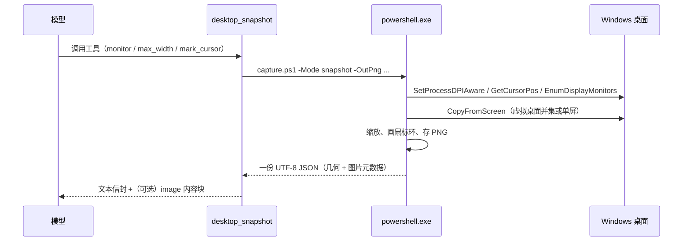

# 桌面视图 · dsh-desktop-view

> 给 [DeepSeek Harness](https://github.com/deepseek-ai/deepseek-harness) 的智能体装上"眼睛"：一个只读插件，让它看见你的 Windows 桌面和鼠标位置。

[English](README.en.md)

| 工具 | 一句话 |
| --- | --- |
| `desktop_snapshot` | 截图（整块虚拟桌面或指定显示器），返回画面 + 鼠标坐标 + 显示器布局 + 窗口标题 |
| `desktop_cursor` | 只读鼠标位置：坐标、所在显示器、指针下的窗口、前台窗口；不截图，几乎零成本 |

两个工具都是**只读**的：不移动鼠标、不点按、不注入按键。

## 它解决什么

智能体平时只能读文件、跑命令，看不到"你正在看的那个东西"。于是"帮我看看这个报错"、"我鼠标停在哪"这类问题，它只能反问。装上这个插件后：

- **看屏幕**：调一次 `desktop_snapshot`，画面直接进入上下文（模型支持图像时内联，否则回一张本地 PNG 的绝对路径）。
- **看鼠标**：调一次 `desktop_cursor`，拿到像素级坐标和指针下的窗口，成本低到可以每步都调。
- **定位控件**：截图附带显示器布局与缩放比例，屏幕坐标和图片坐标同时给出，缩放后自动换算。

## 特性

- **整屏 / 单屏**：默认把多显示器拼成一张图；`monitor` 参数可只截其中一块。
- **DPI 感知**：`SetProcessDPIAware` 之后按物理像素读坐标，200% 缩放下也不会差一半。
- **多显示器**：按虚拟桌面并集处理，左侧副屏的负坐标、主屏的 primary 标记都能正确给出。
- **鼠标环**：`CopyFromScreen` 本身不含光标，所以插件在截图上自己画一圈白环 + 红点 + 十字刻度；`mark_cursor: false` 可关闭。
- **窗口上下文**：同时给出前台窗口与指针下窗口的标题、窗口类名、进程名与 PID。
- **双坐标**：`screen (x, y)` 与 `image (x, y)` 一起返回；图片被 `max_width` 缩小时自动换算。
- **隐私默认值**：纯本地采集，不联网；截图只在 `~/.dsh/desktop-view/snapshots`，自动只留最近 40 张。
- **零原生依赖**：纯 Windows PowerShell 5.1 + .NET `System.Drawing`，不用编译、不用装模块。

## 安装

要求：Windows 10/11、DeepSeek Harness 0.2.x、宿主的 Node ≥ 22。

推荐用 Harness 自带的插件管理器安装本地目录（它会正确写入 profile 的依赖与 patch，不要手改 `package.json` / `cordis.patch.yml`）：

```text
plugin_manager install_bundle  target: <本仓库的绝对路径>
```

或者先克隆再装：

```bash
git clone https://github.com/Gaoler006115/dsh-desktop-view.git
```

然后在 Harness 里对克隆目录执行 `install_bundle`。卸载用 `plugin_manager remove_bundle`；数据目录 `~/.dsh/desktop-view` 可以整体删除。

## 使用

```text
desktop_snapshot(monitor?: 1..N, max_width?: int, mark_cursor?: bool)
desktop_cursor()
```

| 参数 | 默认 | 说明 |
| --- | --- | --- |
| `monitor` | 省略 = 全部显示器 | 用上一次结果里 `monitors[].index` 的编号，只截这一块 |
| `max_width` | `0`（原始分辨率） | 缩小到不超过该宽度；越小越省图像 token，但细节更少 |
| `mark_cursor` | `true` | 在鼠标处画环；关掉可看无遮挡的画面 |

`desktop_snapshot` 的文本部分长这样（窗口标题已脱敏）：

```text
<desktop>
captured: 2026-01-02T03:04:05+08:00
region: virtual-desktop — 4480x1440 at (-2560, 0)
image: C:\Users\me\.dsh\desktop-view\snapshots\desktop-20260102-030405-120.png (2240x720, downscaled from 4480x1440)
pointer: screen (100, 200) · image (50, 100) · monitor 1
monitors:
  - 1: 1920x1080 at (0, 0) primary
  - 2: 2560x1440 at (-2560, 0)
foreground: notepad (pid 42) "Untitled - Notepad"
under pointer: explorer (pid 7) "Program Manager"
display scale: 150%
</desktop>
```

模型路由支持图像输入时，同一条结果还会带上一个 image 内容块（截图本身）；不支持时只给路径，并附一行提示，由调用方决定用哪条路径读图。

## 工作原理



要点：

1. `index.js` 以**原始 JSON-Schema** 注册两个工具，不 import Harness 包——外部 bundle 解析不到宿主依赖，所以参数校验也自己写在 `execute` 里。
2. 每次观测启动一个短命的 `powershell.exe -NoProfile -NonInteractive`，用 `Add-Type` 现场编译一小段 P/Invoke 助手；进程退出即清理。
3. 结果写进临时 JSON 文件再由 Node 读取，**不解析本地化控制台文本**，中文/英文系统的差异不会影响解析。
4. 图像走宿主 `attachments` 服务落成附件；只有当前模型路由声明支持 `image` 输入时才内联，避免把纯文本模型的路由打崩。

## 目录结构

```text
index.js              两个工具的定义与执行编排
lib/scene.js          纯函数：坐标换算、文本信封（可单测，无 I/O）
scripts/capture.ps1   PowerShell 采集器：P/Invoke + 截图 + JSON 输出
locale/{en,zh}.json   插件管理器里的标题与描述
icon.svg              插件图标
test/                 node:test 单元测试
cordis.patch.yml      bundle 的 loader 插入行
```

## 开发

```bash
node --check index.js lib/scene.js
node --test
```

测试不接触真实桌面：纯函数用例直接跑，工具用例用桩 `ctx` 注册后检查 schema、渲染与参数校验。

## 兼容性

- Windows 10 / 11（Windows PowerShell 5.1 自带即可）
- DeepSeek Harness 0.2.x 的工具注册与 `attachments` 服务
- 宿主 Node ≥ 22（`AbortSignal`、ESM、`node:test`）

## 隐私

这个插件会把屏幕内容写进模型上下文——请只在你愿意的情况下使用，并注意截图里可能包含密码、聊天记录、会议画面。所有采集与存储都在本机：没有网络请求，没有遥测，截图目录可随时清空。详见 [SECURITY.md](SECURITY.md)。

## License

[MIT](LICENSE)
